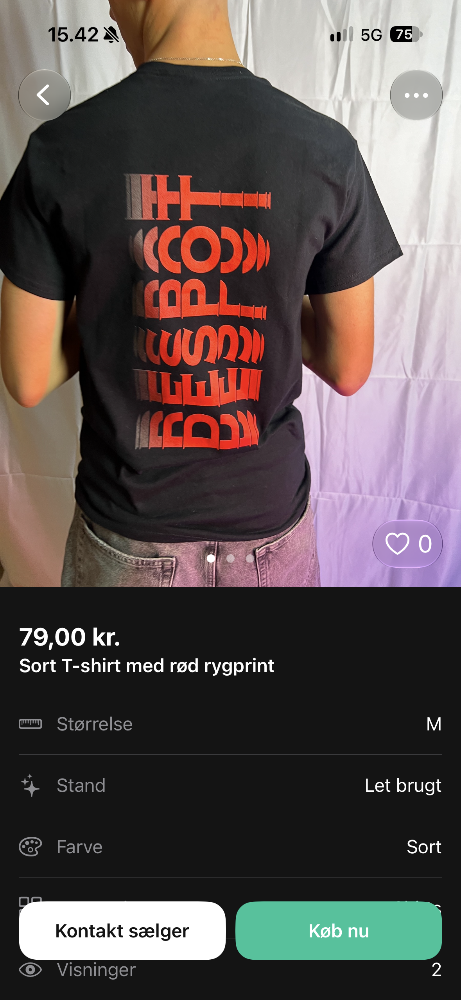
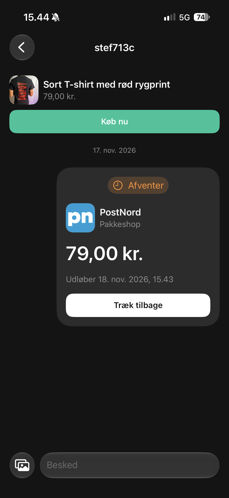
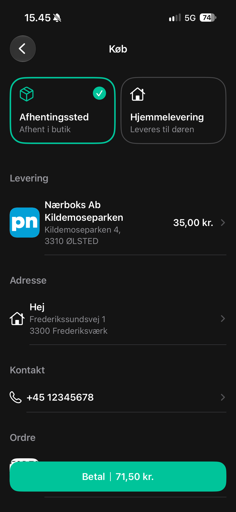
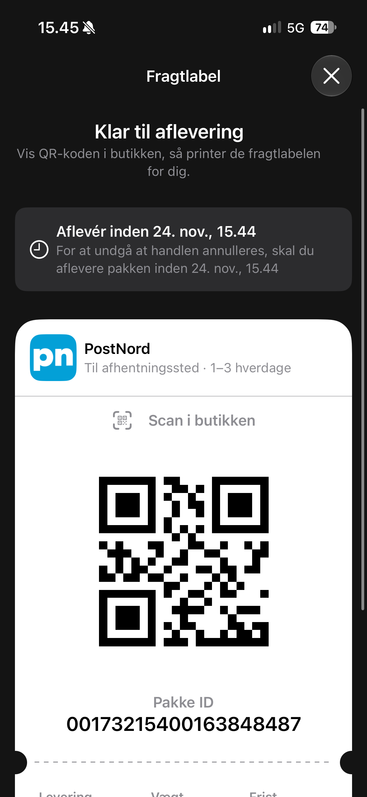
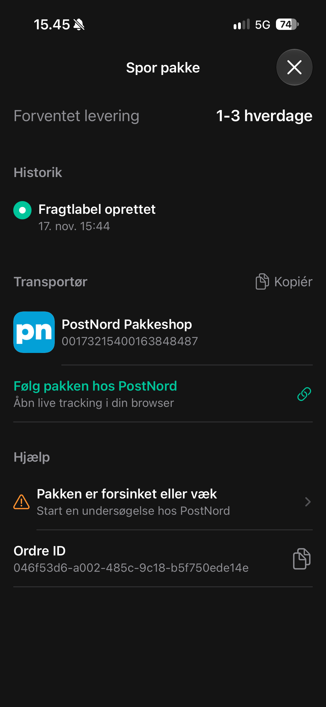

# Fresh Finds – Showcase

Fresh Finds is an iOS marketplace app for buying and selling second-hand items. The app is close to completion.

## Demo

Watch the demo here: https://youtu.be/VHt1Fr5S2Aw

## Screenshots

     

## Features

**Account**
- Sign up with email verification, log in with email, Apple or Google
- Forgot password, log out and delete account
- Animated splash screen and forced update screen
- Banned accounts with limited access

**Browse**
- Home feed
- Search with suggestions and recent searches
- Filters for category, size, color, brand, condition and price, plus sorting
- Product details with images, similar items and view count
- Likes and a list of liked items

**Sell**
- Create, edit and delete listings
- AI fills out the listing form from the first image

**Buy and Shipping**
- Buy now and checkout
- Home delivery or pickup point, with a map of pickup points and carrier selection
- Purchases and sales filtered by status
- Seller creates a shipping label and tracks the parcel
- Buyer confirms delivery

**Chat and Offers**
- Inbox with unread notifications
- Chat with text, images, offers and order messages
- Make, accept, decline and withdraw offers
- Support chat

**Problems and Payments**
- Report a problem with an order
- Full refund, partial refund, rejection or return request
- Return shipping using the same flow as a normal order
- Star reviews on users
- Balance, payouts, transactions and debt

**Profile and Social**
- Own profile and other users' profiles with their items
- Follow users and see followers
- Edit profile, block users and report items, users or messages
- Push notifications

## Tech Stack

- Swift & SwiftUI
- MVVM
- Swift Concurrency (async/await)
- REST API & URLSession
- Firebase
- Node.js backend
- Stripe Connect
- PostNord API

## Architecture

Each screen has a View and a ViewModel. Stores hold data shared between screens, and Services handle the network calls. Services are injected through protocols, so they can be replaced with mocks in tests.

## Source Code

The source code is private because the app will launch as a company. Access can be given during an interview.
